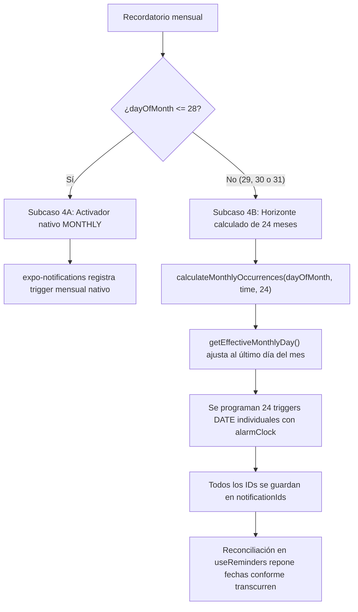

# Contexto Técnico del Proyecto: Remind

Documento de referencia técnica central de la aplicación **Remind**. Debe ser consultado por agentes y desarrolladores en nuevas sesiones para mantener la consistencia arquitectónica, el modelo de datos y la confiabilidad del sistema de alertas.

---

## 1. Propósito de Remind

**Remind** es una aplicación móvil para Android desarrollada con React Native, TypeScript y Expo SDK 58. Su objetivo principal es ofrecer una gestión eficiente, visualmente cuidada y sumamente confiable de recordatorios diarios, semanales, mensuales y de fecha única.

### Principios de diseño
- **Confiabilidad absoluta en notificaciones**: Las alertas deben sonar y mostrarse a tiempo, incluso con la pantalla bloqueada o el teléfono en reposo profundo (Doze mode en Android), utilizando alarmas exactas (`alarmClock`).
- **Diseño oscuro ("Dark UI") inspirado en Samsung One UI**: Interfaz visual optimizada para fondos oscuros (#000000 / #111317), contrastes nítidos y controles táctiles modernos.
- **100% en español**: Todos los textos, formatos de fecha, nombres de meses y mensajes al usuario están en español.
- **Robustez local ("Offline-first")**: Toda la persistencia opera de forma local mediante `AsyncStorage` y la programación nativa del sistema operativo, sin depender de servidores externos.

---

## 2. Tecnologías y Versiones Instaladas

Configuración verificada a partir de `package.json` y `app.json`:

| Tecnología / Paquete | Versión instalada | Propósito en el proyecto |
| :--- | :--- | :--- |
| **Expo SDK** | `~58.0.21` | Plataforma base móvil |
| **React Native** | `0.88.1` | Framework principal |
| **React** | `19.3.0` | Librería UI (React Compiler habilitado) |
| **TypeScript** | `~6.0.3` | Tipado estático estricto |
| **Expo Router** | `~58.0.28` | Navegación basada en archivos (rutas tipadas) |
| **@react-native-async-storage/async-storage** | `2.2.0` | Persistencia local de recordatorios |
| **expo-notifications** | `~58.1.7` | Gestión de canales, permisos y alarmas locales |
| **react-native-reanimated** | `4.7.1` | Animaciones de interfaz |
| **react-native-gesture-handler** | `~3.3.0` | Manejo de gestos táctiles |
| **react-native-screens** | `~4.30.0` | Optimización de memoria en vistas nativas |
| **react-native-safe-area-context** | `~5.10.1` | Gestión de áreas seguras e insets |
| **@react-native-community/datetimepicker**| `9.2.1` | Dependencia auxiliar / plugins de calendario |
| **EAS CLI** | `>= 16.0.0` | Compilación de APKs y gestión de despliegue en Expo Application Services |
| **Node.js Test Runner** | Nativo (`node --test`) | Ejecución de suites de prueba unitarias |

---

## 3. Estructura del Proyecto

Organización del código fuente en `src/`:

```
d:/Proyectos/Remind/
├── assets/                          # Iconos adaptativos, splash e imágenes
│   └── images/
├── docs/                            # Documentación técnica
│   └── PROJECT_CONTEXT.md           # Este documento de referencia
├── src/
│   ├── app/                         # Rutas de Expo Router (solo pantallas y layout)
│   │   ├── _layout.tsx              # Root Layout: ThemeProvider, StatusBar, Splash
│   │   └── index.tsx                # Pantalla principal (RemindersScreen)
│   ├── components/                  # Componentes visuales y modales
│   │   ├── reminders/
│   │   │   ├── calendar-date-picker.tsx   # Selector de calendario oscuro modal
│   │   │   ├── create-reminder-modal.tsx  # Modal de creación y edición
│   │   │   ├── reminder-card.tsx          # Tarjeta interactiva de recordatorio
│   │   │   ├── test-notification-card.tsx # Panel de diagnóstico Beta 0.1
│   │   │   └── wheel-time-picker.tsx      # Selector de hora One UI
│   │   ├── ui/                            # Componentes atómicos reutilizables
│   │   └── animated-icon.tsx              # Overlay de splash animado
│   ├── constants/
│   │   └── theme.ts                 # Paleta de colores (oscuro/claro), espaciados y tipografías
│   ├── hooks/
│   │   ├── use-reminders.ts         # Hook principal de estado, sincronización y CRUD
│   │   ├── use-theme.ts             # Hook de tema activo
│   │   └── use-color-scheme.ts      # Detección de esquema de color
│   ├── services/
│   │   ├── notification-service.ts  # Servicio integral de expo-notifications
│   │   └── reminder-storage.ts      # Persistencia en AsyncStorage y migraciones
│   ├── types/
│   │   └── reminder.ts              # Definiciones TypeScript (Reminder, RepeatType, etc.)
│   ├── utils/
│   │   ├── reminder-dates.ts        # Cálculo de fechas, horizonte 24 meses y formato español
│   │   └── wheel-time-utils.ts      # Matemáticas, ciclos y parseo del WheelTimePicker
│   └── __tests__/                   # Suites de pruebas automatizadas
│       ├── monthly-reminders.test.ts # Pruebas del horizonte de días 28-31
│       └── wheel-time-picker.test.ts # Pruebas del selector de tiempo
├── AGENTS.md                        # Reglas operativas para agentes AI
├── app.json                         # Configuración Expo, permisos Android y plugins
├── eas.json                         # Perfiles de compilación EAS (preview APK y production)
├── package.json                     # Dependencias y scripts
└── tsconfig.json                    # Configuración estricta de TypeScript
```

---

## 4. Componentes Principales

### 4.1 Pantalla Principal (`src/app/index.tsx`)
- Renderiza la lista completa de recordatorios mediante un `FlatList` optimizado.
- Cabecera con título en español (`"Mis recordatorios"`), subtítulo motivacional y badge con contador reactivo de recordatorios activos.
- Integra como `ListHeaderComponent` el panel colapsable `TestNotificationCard`.
- Botón de acción flotante (FAB) `"＋ Nuevo recordatorio"` posicionado considerando los `insets` de navegación de Android.
- Maneja la apertura y cierre del modal `CreateReminderModal` tanto para creación como para edición.

### 4.2 Tarjeta de Recordatorio (`src/components/reminders/reminder-card.tsx`)
- Muestra badge de categoría con icono emoji y color diferenciado (`salud`, `hogar`, `finanzas`, `personal`, `general`).
- Control de activación inmediata mediante `Switch`, con contenedor interactivo protegido (`onStartShouldSetResponder`) para evitar disparar la edición accidental al conmutar el estado.
- Botón de eliminación directa (`✕`) y visualización de horario (`⏰`) y frecuencia formateada (`📅`).
- Estilos visuales con atenuación de opacidad cuando el recordatorio está inactivo/pausado.

### 4.3 Modal de Creación / Edición (`src/components/reminders/create-reminder-modal.tsx`)
- Formulario modal que soporta alta y modificación completa.
- Campos: Título, Categoría (selector visual horizontal), Hora (apertura de `WheelTimePicker`), y Tipo de Repetición (`once`, `daily`, `weekly`, `monthly`).
- Adaptación dinámica según frecuencia:
  - **Una sola vez**: Despliega fecha objetivo con botón para abrir `CalendarDatePicker` en modo `'date'`.
  - **Todos los días**: Configura disparo diario automático.
  - **Días específicos**: Botones circulares para los 7 días de la semana (`D`, `L`, `M`, `X`, `J`, `V`, `S`).
  - **Mensualmente**: Muestra el día del mes seleccionado y botón para abrir `CalendarDatePicker` en modo `'dayOfMonth'`.
- Inicialización dinámica de fechas locales (evita sesgos UTC).

### 4.4 Panel de Diagnóstico Beta 0.1 (`src/components/reminders/test-notification-card.tsx`)
- Componente colapsable situado al inicio de la lista.
- Permite programar una notificación de prueba a 60 segundos con temporizador reactivo basado en reloj absoluto (`Date.now()`), sincronizado al volver de segundo plano (`AppState`).
- Botón de inspección del sistema (`getAllScheduledNotifications`) que lista los identificadores nativos y metadatos registrados en el runtime de Android.
- Botón de vista previa de fechas calculadas para recordatorios mensuales (días 28 nativo y 31 en horizonte).

---

## 5. Modelo de Datos de Recordatorios

Ubicación: `src/types/reminder.ts`

```typescript
export type ReminderCategory = 'salud' | 'hogar' | 'finanzas' | 'personal' | 'general';

export type RepeatType = 'once' | 'daily' | 'weekly' | 'monthly';

export interface Reminder {
  id: string;                 // Identificador único (timestamp numérico como string)
  title: string;              // Título descriptivo
  time: string;               // Formato 12h: "08:00 AM", "06:30 PM"
  frequency: string;          // Resumen textual: "Todos los días", "Cada Mar, Jue", etc.
  repeatType?: RepeatType;    // Tipo de repetición normalizado
  targetDate?: string;        // Formato "YYYY-MM-DD" (exclusivo para repeatType === 'once')
  dayOfMonth?: number;        // Día del mes (1 - 31) para repeatType === 'monthly'
  days?: string[];            // Subconjunto de ['D', 'L', 'M', 'X', 'J', 'V', 'S'] para 'weekly'
  isActive: boolean;          // Estado activo / pausado
  category?: ReminderCategory;// Categoría visual
  createdAt: number;          // Timestamp de creación
  notificationId?: string;    // ID único de notificación (compatibilidad heredada)
  notificationIds?: string[]; // IDs de todas las notificaciones programadas (semanales y horizonte)
}
```

---

## 6. Persistencia con AsyncStorage

Ubicación: `src/services/reminder-storage.ts`

- **Claves de almacenamiento**:
  - `@remind_app/reminders_v1`: Arreglo serializado en JSON con todos los recordatorios.
  - `@remind_app/has_initialized_v1`: Bandera booleana para distinguir la primera ejecución de una lista vaciada voluntariamente por el usuario.
- **Flujo de primera ejecución**: Si `has_initialized_v1` y `reminders_v1` son nulos, se guardan los datos iniciales de muestra (`INITIAL_REMINDERS`) y se marca la bandera. Si el usuario borra todos sus recordatorios, la app permanece vacía y no regenera los ejemplos.
- **Diferenciación estricta entre error y lista vacía**: La función `getStoredReminders` lanza `StorageReadError` ante fallos de I/O o datos JSON corruptos. Esto impide que un fallo transitorio de lectura sea interpretado como una lista vacía, protegiendo las notificaciones programadas contra cancelaciones erróneas.
- **Cola asíncrona secuencial (`AsyncQueue`)**: Todas las escrituras y modificaciones (`addReminder`, `updateReminder`, `toggleReminder`, `deleteReminder`) se procesan secuencialmente en orden FIFO. Se eliminaron todos los efectos secundarios dentro de actualizadores de estado de React, evitando condiciones de carrera y escrituras fuera de orden cuando se interactúa rápidamente con la interfaz.
- **Migración transparente (`migrateReminder`)**: Si un recordatorio antiguo carece de `repeatType`, la función analiza el texto de `frequency` o el arreglo `days` y deduce de forma determinista el tipo (`monthly`, `weekly`, `once` o `daily`), rellenando `dayOfMonth`, `targetDate` o `days` sin pérdida de información.

---

## 7. Programación de Notificaciones

Ubicación: `src/services/notification-core.ts` y `src/services/notification-service.ts`

### 7.1 Configuración Nativa en Android
- **Canal de notificación**:
  - ID: `recordatorios` (`ANDROID_CHANNEL_ID`)
  - Nombre: `"Recordatorios"`
  - Importancia: `AndroidImportance.HIGH`
  - Patrón de vibración: `[0, 250, 250, 250]`
  - Color de luz: `#2563EB`
  - Visibilidad: `AndroidNotificationVisibility.PUBLIC`
  - *Regla crítica*: No se especifica el parámetro `sound` en la creación del canal en JS, permitiendo que Android inicialice los `AudioAttributes` del canal por defecto. Esto previene un `NullPointerException` en el runtime nativo de Android.
- **Permisos requeridos en `app.json`**:
  - `android.permission.POST_NOTIFICATIONS` (Android 13+ / API 33+)
  - `android.permission.RECEIVE_BOOT_COMPLETED` (reprogramación tras reinicio)
  - `android.permission.VIBRATE`
  - `android.permission.SCHEDULE_EXACT_ALARM`
  - `android.permission.USE_EXACT_ALARM`
- **Entrega de precisión**: Todos los triggers utilizan `delivery: 'alarmClock'`, lo que indica a Android que debe despertar el dispositivo incluso bajo restricciones estrictas de batería.

### 7.2 Tipos de Triggers y Resiliencia ante Fallos Parciales
1. **Una sola vez (`once`)**:
   - `SchedulableTriggerInputTypes.DATE`
   - Parsea la fecha local `targetDate` (YYYY-MM-DD) y la hora `time`.
   - Si la fecha y hora ya pasaron en relación con `Date.now()`, no programa la notificación y devuelve el error controlado `PAST_DATETIME`.
2. **Diario (`daily`)**:
   - `SchedulableTriggerInputTypes.DAILY`
   - Se programa con `hour` y `minute` parseados a formato 24 horas. Metadatos incluyen `time` para validar frescura en reconciliación.
3. **Semanal (`weekly`)**:
   - Se crea un trigger individual `SchedulableTriggerInputTypes.WEEKLY` por cada día marcado en `reminder.days`.
   - **Rollback ante fallos parciales**: Si la programación de algún día falla a mitad del proceso, se cancelan automáticamente las notificaciones programadas previas en ese intento, impidiendo alertas huérfanas en Android.
4. **Mensual (`monthly`)**: Ver sección 8.

### 7.3 Reconciliación Robusta (`reconcileScheduledNotifications`)
- Se ejecuta al abrir la aplicación a través del hook `useReminders`.
- **Limpieza de huérfanas**: Identifica notificaciones nativas con `data.reminderId` cuyo recordatorio ya no existe o está inactivo y las cancela.
- **Protección de notificaciones ajenas**: No cancela notificaciones de diagnóstico (`type === 'test_notification'`) ni de módulos ajenos.
- **Deduplicación**: Si existen notificaciones duplicadas para un mismo recordatorio o día, conserva solo una y cancela los duplicados redundantes.
- **Detección de obsolescencia**: Si la hora, la frecuencia o los días cambiaron, cancela los disparadores viejos y programa los nuevos.
- **Confirmación de cancelación**: Las funciones de cancelación no reportan éxito a menos que todos los IDs objetivo hayan sido cancelados efectivamente.

---

## 8. Estrategia Especial para Días 29, 30 y 31

Ubicación: `src/utils/reminder-dates.ts` y `src/services/notification-service.ts`

### 8.1 El Problema Técnico de Android / Expo
El activador nativo mensual de `expo-notifications` (`SchedulableTriggerInputTypes.MONTHLY`) recibe un parámetro `day` (1 a 31). Sin embargo, en el sistema operativo subyacente:
- Si se programa para el día 31, la alarma simplemente **no suena** en meses de 30 días (abril, junio, septiembre, noviembre) ni en febrero (28 o 29 días).
- Si se programa para el día 29 o 30, falla en febrero de años comunes o bisiestos.

### 8.2 La Solución Implementada
La aplicación divide la lógica mensual en dos esquemas:



1. **Días 1 al 28**:
   - Utilizan el activador nativo `SchedulableTriggerInputTypes.MONTHLY` con `day: dayOfMonth`, `hour` y `minute`. Todos los meses del año contienen estos días.
2. **Días variables (29, 30 y 31)**:
   - Se utiliza la función `calculateMonthlyOccurrences(dayOfMonth, timeStr, 24, fromDate)`.
   - Para cada uno de los siguientes 24 meses calendario, se calcula el día efectivo con `getEffectiveMonthlyDay(dayOfMonth, year, month)`:
     - En meses de 31 días: se mantiene el día 31.
     - En meses de 30 días: el día 31 se ajusta automáticamente al **día 30**.
     - En febrero de año común (ej. 2027): el día 29, 30 o 31 se ajusta al **día 28**.
     - En febrero de año bisiesto (ej. 2028): el día 29, 30 o 31 se ajusta al **día 29**.
     - El valor base configurado por el usuario (`dayOfMonth: 31`) **nunca se muta**, por lo que en el mes siguiente vuelve a sonar el día 31.
   - Cada ocurrencia se programa como un trigger exacto `SchedulableTriggerInputTypes.DATE` con entrega `alarmClock`.
   - Se generan y conservan 24 identificadores en el arreglo `notificationIds`.
   - Durante la reconciliación periódica en `reconcileScheduledNotifications`, la app detecta qué fechas del horizonte ya se consumieron y programa únicamente las fechas faltantes al final del horizonte, evitando duplicados y manteniendo siempre cobertura de 24 meses hacia adelante.

---

## 9. Selectores Personalizados de Hora y Calendario

Para garantizar que la experiencia sea completamente oscura y consistente en cualquier versión de Android, se implementaron componentes propios que sustituyen los diálogos blancos predeterminados del sistema:

### 9.1 `WheelTimePicker` (`src/components/reminders/wheel-time-picker.tsx`)
- Modal oscuro (`#000000`) estilo One UI para seleccionar hora, minutos y período (`a.m.` / `p.m.`).
- Utiliza tres listas verticales sincronizadas mediante `FlatList` con `snapToInterval={ITEM_HEIGHT}` (64px).
- Centraliza la selección mediante cálculo de offset y `settle()`.
- Utilidades en `src/utils/wheel-time-utils.ts`:
  - `parseTimeToState()`: Convierte cualquier cadena (ej. `"08:00 AM"`, `"6:00 PM"`, `"12:00 AM"`) a hora 12h, minuto y período.
  - `formatSelectedTime()`: Ensambla el string final `"HH:MM AM/PM"`.
  - Generación de arreglos extendidos para simular bucle (`HOURS_DATA` de 120 ciclos = 1440 elementos, `MINUTES_DATA` de 60 ciclos = 3600 elementos).

### 9.2 `CalendarDatePicker` (`src/components/reminders/calendar-date-picker.tsx`)
- Modal oscuro para selección de fechas y días.
- Ofrece dos modos de operación según la prop `mode`:
  1. `mode="date"`: Selección de año, mes y día para recordatorios de "Una sola vez". Retorna formato `YYYY-MM-DD`.
  2. `mode="dayOfMonth"`: Cuadrícula para seleccionar un día específico (1 al 31) para recordatorios "Mensualmente". Retorna un valor numérico entre 1 y 31.
- Encabezado con navegación de mes anterior/siguiente (`‹` y `›`), fila con días de la semana en español (`D`, `L`, `M`, `X`, `J`, `V`, `S`) y resaltado del día seleccionado y del día de hoy.

---

## 10. Comandos de Desarrollo, Pruebas y Compilación

| Comando | Función |
| :--- | :--- |
| `npx expo start` | Inicia el servidor de desarrollo Metro para depurar la aplicación. |
| `npx expo lint` | Ejecuta el linter ESLint según la configuración de Expo. |
| `npx tsc --noEmit` | Ejecuta el análisis de tipos de TypeScript sin emitir archivos. |
| `npm test` | Ejecuta la suite de pruebas unitarias con Node.js (`src/__tests__/**/*.test.ts`). |
| `eas build --profile preview --platform android` | Genera la APK Beta instalable para Android en los servidores de EAS. |

> [!IMPORTANT]
> - Ejecutar siempre `npx tsc --noEmit` y `npx expo lint` antes de dar por finalizada cualquier modificación.
> - **No ejecutar compilaciones de EAS (`eas build`) sin autorización expresa del usuario.**

---

## 11. Estado de la APK Beta 0.1

- Se ha compilado y validado en hardware Android real la versión **APK Beta 0.1** (generada con el perfil `preview` de EAS Build).
- **Resultados de prueba en dispositivo**:
  - Recepción de notificaciones comprobada en primer plano, segundo plano y con pantalla bloqueada / reposo.
  - Despertar efectivo del dispositivo mediante `alarmClock`.
  - Operación correcta de la migración de datos de versiones previas.
  - El panel de diagnósticos (`TestNotificationCard`) permite verificar el ciclo de vida de los triggers en el dispositivo.

---

## 12. Limitaciones Conocidas

1. **Gestión de batería de fabricantes de Android**: Capas fuertemente personalizadas (MIUI/HyperOS de Xiaomi, One UI de Samsung, ColorOS de Oppo/Realme) pueden forzar la detención de procesos en segundo plano. Si un usuario no recibe alertas con la pantalla apagada, se debe sugerir desactivar el "Ahorro de batería" para Remind en los ajustes del sistema Android.
2. **Ventana del horizonte mensual (24 meses)**: Los recordatorios mensuales de los días 29, 30 y 31 están cubiertos hasta 24 meses hacia adelante. Si el usuario pasa más de 2 años sin abrir la app, no habrá fechas programadas más allá de esa ventana hasta que vuelva a abrir la aplicación para que la reconciliación extienda el horizonte.
3. **Expo Go vs. Notificaciones Exactas**: Expo Go no admite la totalidad de comportamientos de alarmas exactas nativas (`alarmClock`) ni la recreación tras reinicio. El desarrollo y prueba de notificaciones debe realizarse sobre development builds o APKs compiladas.

---

## 13. Tareas Pendientes

### 13.1 Próxima tarea: Mejora de `WheelTimePicker`
Estado: **Pendiente de implementación (No implementar hasta indicación del usuario)**.

**Objetivos de la mejora**:
1. **Desplazamiento circular infinito real**:
   - Lograr que el desplazamiento de horas (1-12) y minutos (00-59) sea verdaderamente infinito y continuo en ambas direcciones.
   - Permitir transiciones fluidas de 12 a 1 y de 1 a 12 en horas; y de 59 a 00 y de 00 a 59 en minutos.
2. **Inercia y fluidez mejoradas**:
   - Ajustar el comportamiento de desaceleración y fricción para que la inercia del scroll se sienta natural y el frenado ("snapping") en el elemento central sea suave y preciso.
   - Evitar bloqueos o saltos visuales bruscos durante el recentrado automático.
3. **Preservación visual estricta**:
   - Conservar exactamente el diseño visual oscuro actual (#000000, tipografía grande centrada para el elemento seleccionado, texto atenuado para los laterales, dos puntos `:`, y botones Cancelar / Aceptar).
   - Mantener intacta la API de props de `WheelTimePicker` (`visible`, `initialTime`, `onConfirm`, `onCancel`).

**Archivos involucrados**:
- `src/components/reminders/wheel-time-picker.tsx`
- `src/utils/wheel-time-utils.ts`
- `src/__tests__/wheel-time-picker.test.ts`

### 13.2 Funcionalidades futuras adicionales
- Soporte para sonido persistente de alarma o selección de tono.
- Creación de categorías personalizadas por el usuario.
- Búsqueda y filtrado de recordatorios por categoría o palabra clave.
- Opciones de aplazar ("Snooze") recordatorios desde la notificación de Android.

